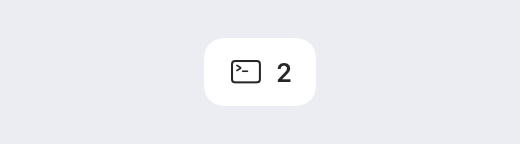
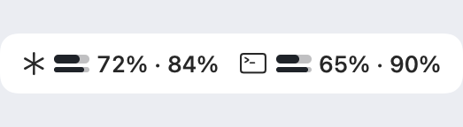
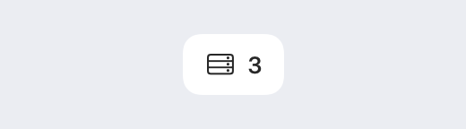
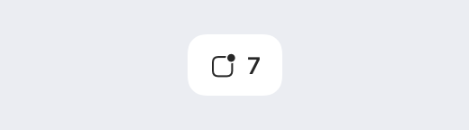
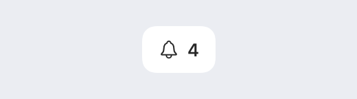
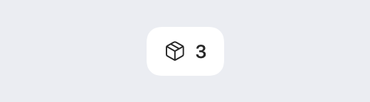
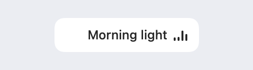
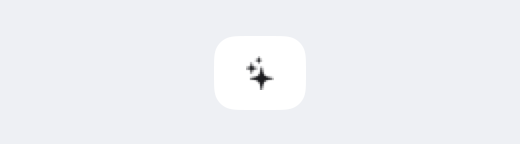
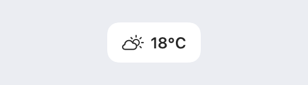

# StableBar store

Widgets and themes for [StableBar](https://github.com/Seb-GRAF/StableBar), the native macOS bar. 
Every package is open source, checked here and published by this repository's CI, not by its author.

[**Packages**](#packages) · [Request a package](https://github.com/Seb-GRAF/stablebar-packages/issues/new?template=package_request.yml) · [Add your own](CONTRIBUTING.md) · [StableBar guide](https://github.com/Seb-GRAF/StableBar/blob/main/docs/packages.md)

## Get a package

In StableBar, open **Settings → Packages → Store** and select a package. Its page shows the widgets it adds, the settings it asks for and the access it needs. Choose **Add to bar** to install and turn it on. Store themes also appear in **Settings → Theme**, where **Get** installs and selects one.

When a newer version is published, Packages lists it under **Updates available**. StableBar never updates a package by itself. If the new version runs new commands, contacts new hosts or needs new permissions, StableBar lists them and asks first. The old version stays installed, so you can go back to it.

From the command line, `StableBar --install-package weather` installs a package without turning it on.

## Packages

Clock & date, Battery, System monitor, Network and Calendar now ship with StableBar Essentials. [Update StableBar](https://github.com/Seb-GRAF/StableBar/releases/latest) to turn existing Store versions into built-in widgets automatically, keeping your settings and placement.

<!-- packages -->
| Preview | Package | Access |
| --- | --- | --- |
|  | **[Agent status](packages/agent-status)** Shows Claude Code waiting or finishing and Codex finishing. Add Claude's Notification, Stop and UserPromptSubmit hooks and Codex's notify command using this package's README. | Runs commands Needs jq |
|  | **[AI usage](packages/ai-usage)** Shows your Claude Code and Codex limits in one widget, with reset countdowns and weekly pace, using the sign-ins those tools already keep. | Runs commands Contacts api.anthropic.com, chatgpt.com |
|  | **[Amphetamine](packages/amphetamine)** Toggle Amphetamine from the bar, adjust its timer with an inline hover slider, and see the time remaining. | Runs commands Permissions: automation |
|  | **[Development servers](packages/dev-servers)** Lists your listening TCP ports and their processes, with actions to open localhost or stop a process. | Runs commands Needs jq |
|  | **[Dock badges](packages/dock-badges)** Shows the total unread count from running apps' Dock badges, with a popup that opens each app. | Runs commands Needs jq |
|  | **[GitHub notifications](packages/github-notifications)** Shows your unread GitHub notification count and lists the latest ones, each opening on GitHub. | Runs commands Contacts api.github.com |
|  | **[Homebrew outdated](packages/homebrew-outdated)** Shows how many Homebrew formulae and casks are outdated, and lists them. | Runs commands Needs brew |
|  | **[Now playing](packages/now-playing)** Shows the playing or paused track from Music or Spotify with its artwork and bouncing bars while it plays, and a popup with seeking, volume, shuffle, repeat and favorites. | Runs commands Permissions: automation Contacts i.scdn.co |
|  | **[Quick ask](packages/quick-ask)** Ask Claude Code or Codex from the bar. Choose the model and effort, follow up, retry, and drag the chat anywhere to keep it on screen. Needs claude or codex signed in. | Runs commands Needs jq Contacts api.anthropic.com, chatgpt.com, api.openai.com |
|  | **[Weather](packages/weather)** Shows the current temperature and conditions from wttr.in, with feels-like, humidity, wind and today's high and low. | Runs commands Contacts wttr.in |
<!-- /packages -->

Previews show sample data. On your bar, a package takes the look of your theme.

## What a package can do

| Kind | What it can do | Who checks it |
| --- | --- | --- |
| Theme | Sets colors, fonts and styles. Runs no commands. | CI |
| Widgets | Uses StableBar's built-in widgets, popups and system data. Runs no commands; StableBar refuses one that tries. | CI |
| Commands | Runs scripts as you, so it can do anything you can. | CI, then a maintainer reads every script and command, for every version |

The Access column lists what each package declares: the command-line tools it needs, the macOS permissions it uses and the hosts it contacts. StableBar shows these before you add a package but doesn't enforce them. For a package that runs commands, a maintainer checks them against the code before it is published.

## How packages reach your Mac

When a pull request merges, CI publishes the `store` release of this repository: an `index.json` listing each package's current version, and one archive for every version ever published. StableBar downloads the index and an archive over HTTPS, checks the archive against the SHA-256 in the index, and reviews it with the same code that reviews a local folder. Each version in the index links the commit it was built from.

A published version never changes and its archive is never deleted. A version you installed stays on your Mac until you remove it, so a configuration that pins it keeps working.

## Report a problem

- A package doesn't work: [report a package bug](https://github.com/Seb-GRAF/stablebar-packages/issues/new?template=package_bug.yml).
- A package does something it doesn't declare, or puts your data at risk: report it privately, as described in [SECURITY.md](.github/SECURITY.md).
- StableBar itself: [StableBar's issues](https://github.com/Seb-GRAF/StableBar/issues).

## Add a package

Packages come in through pull requests. [CONTRIBUTING.md](CONTRIBUTING.md) covers the package folder, the rules CI checks, testing on your Mac and the review.

## License

[MIT](LICENSE)
